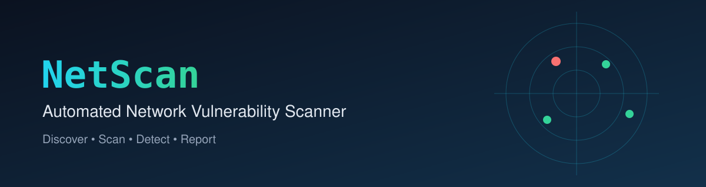
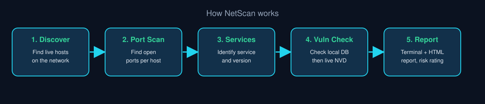
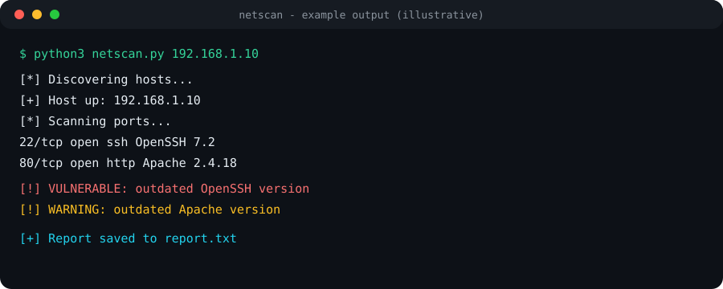

<p align="center"></p>

<p align="center">
  
  
  
  
</p>

# NetScan: Automated Network Vulnerability Scanner

NetScan scans a target with **Nmap**, detects the services and versions running on open ports, and checks them against known vulnerabilities. It then prints a terminal report and creates an **HTML report with an overall risk rating**.

## Why this project?
Checking every service by hand against vulnerability databases is slow. NetScan automates it: scan, identify, match, report.

## How it works
<p align="center"></p>

1. **Scan**: runs Nmap with service/version detection on the target
2. **Parse**: reads Nmap's XML output (open ports, service names, versions)
3. **Local check**: looks each service up in `vuln_db.json`, a curated list of known vulnerabilities (fast, works offline)
4. **Live check**: for services not found locally, queries the **NVD (National Vulnerability Database)** API
5. **Report**: prints results in the terminal and generates `report.html` with an overall risk rating

## Example output
<p align="center"></p>

## Project structure
```
netscan/
├── netscan.py        # main scanner (Nmap wrapper + vuln matching + report)
├── vuln_db.json      # local curated vulnerability database
├── sample_scan.xml   # sample Nmap output to test without scanning
├── report.html       # example generated HTML report
└── README.md
```

## Setup
```bash
git clone https://github.com/dd8639806-creator/netscan.git
cd netscan
```
Install Nmap first: `brew install nmap` (Mac) or `sudo apt install nmap` (Linux). No extra Python packages are needed.

## Usage
```bash
python3 netscan.py <target>
```
Run `python3 netscan.py -h` to see all options.

## Report preview
Add a screenshot of your `report.html` here:


## Limitations
- Version-based matching can give false positives, verify findings manually
- Live NVD lookups need an internet connection
- Depends on Nmap being installed

## Future improvements
- Export to PDF
- Scheduled scans and comparison with previous results
- Larger local vulnerability database

## Disclaimer
For **educational purposes only**. Scan only systems you own or have written permission to test.

## Author
**B.S.S.D. Praveen**: B.Tech CSE (Cybersecurity), RRIT, Bangalore
